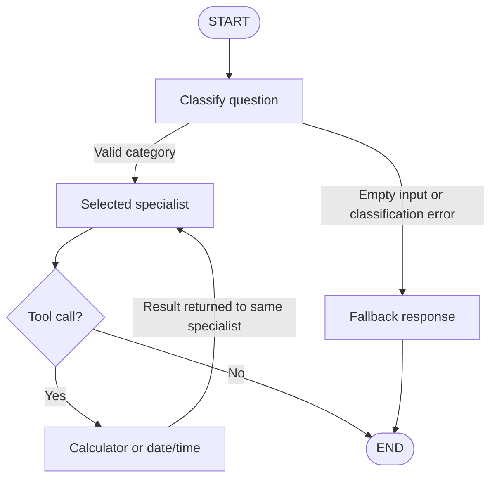

# Local University Assistant with LangGraph and Ollama

A practical project exploring AI agents with **LangGraph**, **LangChain**, and **Qwen3.5:4b** running locally through **Ollama**.

The project progresses from a simple message-processing graph to a university assistant that routes questions, uses tools, and maintains conversation history.

**Author:** Loubna El Ghazi

## Features

- Local inference without an OpenAI API key
- Multi-step question analysis and answer generation
- Conditional routing to specialized agents
- Calculator and current date/time tools
- Conversation memory separated by thread ID
- Fallback responses for empty questions
- Routing evaluation and tool-call inspection

## Technologies

| Technology | Role |
|---|---|
| Python | Application logic and tools |
| LangChain | Model integration and message handling |
| LangGraph | Workflow execution, routing, and state |
| Ollama | Local model serving |
| Qwen3.5:4b | Classification, answer generation, and tool requests |
| Jupyter Notebook | Interactive exercises and execution outputs |
| pandas | Evaluation results |

## Setup

### 1. Install dependencies

Run inside your Python environment:

```bash
python -m pip install -U langgraph langchain langchain-ollama langchain-community pandas jupyterlab
```

The lab was executed using Python 3.10.

### 2. Download the model

Install [Ollama](https://ollama.com), then run:

```bash
ollama pull qwen3.5:4b
```

If Ollama is not already running, start it in another terminal:

```bash
ollama serve
```

### 3. Configure the model

```python
from langchain_ollama import ChatOllama

llm = ChatOllama(
    model="qwen3.5:4b",
    base_url="http://localhost:11434",
    temperature=0,
    reasoning=False,
    num_ctx=8192,
)
```

Ollama must be reachable from the Python environment at the configured address.

## Run the Project

### Notebook

```bash
jupyter lab
```

Open the project notebook, select your Python environment, and run the cells from top to bottom.

The notebook redefines some functions and state classes between exercises, so execution order matters.

### Python script

If using the exported source file:

```bash
python langgraph_lab.py
```

Remove the notebook-only `get_ipython().run_line_magic(...)` installation line before running the exported script directly.

## Lab Progression

1. **Basic graph:** understand state, nodes, edges, START, and END.
2. **LLM integration:** generate responses using the local model.
3. **Multi-step workflow:** analyze a question before answering.
4. **Conditional routing:** select mathematics, programming, or AI processing.
5. **Tools:** execute calculations and retrieve the current date/time.
6. **Memory:** preserve conversation history across calls.
7. **Evaluation:** inspect routing accuracy and execution time.
8. **Final assistant:** combine routing, tools, memory, and error handling.

## Architecture

The final assistant classifies questions into five categories:

- **COURSES:** course content and study guidance
- **PROGRAMMING:** programming explanations and examples
- **MATHEMATICS:** mathematical questions and calculations
- **ADMINISTRATION:** general university procedures
- **GENERAL:** other questions

The specialists use the same local model with different system prompts.



The selected category is stored in state so that tool results return to the correct specialist.

## Tools

### Calculator

The active calculator parses arithmetic expressions with Python's `ast` module and allows selected arithmetic operations.

Examples:

```text
25 * 4 + 10    → 110
125 * 38      → 4750
(15 + 27) * 3 → 126
```

Unsupported expressions such as `__import__('os')` are rejected.

The notebook includes an unsafe `eval()` example for comparison, but that version is not bound to the assistant.

### Current date and time

The date/time tool reads the local system clock. Its output depends on the machine's date and timezone.

## Conversation Memory

The assistant uses `MemorySaver` and a `thread_id` to preserve conversation state between calls.

```python
config = {
    "configurable": {
        "thread_id": "conversation-1"
    }
}
```

- The same thread ID restores the same conversation history.
- Different thread IDs maintain separate histories.
- Memory is stored in RAM and is lost when the kernel or process restarts.

Remembering information means supplying earlier messages as context; it does not train or modify the model.

## Recorded Results

### Routing evaluation

The three-category router correctly classified all six test questions.

| Question | Predicted category | Workflow time |
|---|---|---|
| Derivative of x² | Mathematics | 5.29 s |
| Solve 2x + 3 = 11 | Mathematics | 3.18 s |
| Reverse a Python list | Programming | 10.25 s |
| Write a palindrome function | Programming | 7.48 s |
| Explain a convolutional neural network | Artificial intelligence | 17.00 s |
| Explain overfitting | Artificial intelligence | 23.61 s |

**Observed routing accuracy: 6/6 (100%).**

These times include classification and answer generation. The evaluation covers six examples and measures category selection, not the correctness of every generated answer.

### Functional checks

| Test | Observed behavior |
|---|---|
| Multiplication question | Requested the calculator and used its result |
| Capital of Morocco | Answered Rabat without a tool call |
| Name recall without checkpointing | Did not recall the name |
| Name recall within the same thread | Recalled Ahmed |
| Separate conversation thread | Did not recall the other thread's name |
| Empty question | Returned a fallback response |
| Unsupported calculator expression | Returned `Invalid expression` |

The final demonstration also selected the intended categories for the five sample university questions.

## Design Choices

- **Local inference:** use Ollama instead of a hosted model API.
- **Shared state:** pass information between workflow steps.
- **Specialized prompts:** reuse one model for different roles.
- **Conditional edges:** choose the next step based on state.
- **Tool execution:** let Python perform calculations requested by the model.
- **Checkpointing:** preserve messages between conversation turns.

## Limitations

- Classification and generated answers can be incorrect.
- No official university database is connected, so administrative guidance remains general.
- The evaluation dataset is small.
- Routing uses text matching rather than validated structured output.
- The calculator does not impose explicit computation limits.
- Conversation memory is temporary.
- PNG graph rendering may require access to an external Mermaid service; Mermaid source can be used as a fallback.
- The date/time tool's `_` argument produced a Pydantic warning in the recorded run.

## Project Materials

- Jupyter notebook with code, explanations, and execution outputs
- Exported Python source code
- Architecture diagrams
- Short report presenting the concepts, results, and conclusion
